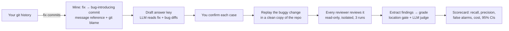

# ReviewReplay

**Would your AI code reviewer have caught the bugs you already shipped?**

ReviewReplay benchmarks AI code reviewers — Claude Code, Codex, Gemini CLI, your own review
prompts and skills — on **the real bugs from your own repository's history**. It finds commits
that introduced a bug (using the later fix), replays each one as an uncommitted change in the full
project, asks every reviewer to review it, and scores what each one catches, what it gets wrong,
and what it costs.

[](docs/media/reviewreplay-launch.mp4)

<sub>▶ [Watch the 21-second launch video, with sound](docs/media/reviewreplay-launch.mp4): a real bug from
pallets/click, rewound to the commit that caused it and replayed to Claude Code.</sub>

[](LICENSE)


> **v0.1, built in public.** The method and the tool work; the results are early (12 graded real
> bugs from 9 projects, judge agreement checked against a second model, not yet a person). Read the numbers as a direction. Progress, new cases and corrections land here as they
> happen, and [contributions are welcome](CONTRIBUTING.md).

```bash
pip install git+https://github.com/GgauravJ05/reviewreplay
cd your-repo
reviewreplay doctor                   # git, claude, Python and the cache folder; spends nothing
reviewreplay init --dry-run           # which fixed bugs it would use; spends nothing
reviewreplay init                     # mine your fixed bugs into draft test cases
reviewreplay run --cases .reviewreplay/cases --out .reviewreplay/results --include-drafts --dry-run
reviewreplay run --cases .reviewreplay/cases --out .reviewreplay/results --include-drafts
reviewreplay report .reviewreplay/results
```

`run --dry-run` prints the number of reviews, the cost and the time before anything runs. The
estimate uses the committed reviews: about $0.06 and 15 seconds per review. For 12 cases, 2
reviewers and 3 runs, that's about $4.25 and 6 minutes. A stopped run resumes where it left off.

## Use it in CI

The ReviewReplay GitHub Action re-scores your reviewer when its subject file or your cases change,
and comments the scorecard on the pull request:

```yaml
- uses: GgauravJ05/reviewreplay@main
  with:
    subjects: baseline,our-reviewer
    anthropic-api-key: ${{ secrets.ANTHROPIC_API_KEY }}
```

Setup, inputs, cost and safety are in [docs/github-action.md](docs/github-action.md).

## Why

Teams are adopting AI code review on faith. Public benchmarks test reviewers on shared,
public pull requests: useful, but not *your* code, your conventions or your kinds of bugs, and
public code may already be in the model's training data. ReviewReplay answers the question
each team actually has:

- **Which reviewer should we use?** Compare tools on bugs from your codebase, side by side.
- **Did our new review prompt or skill help?** Measure before and after, with confidence intervals.
- **What does it cost?** Dollars, time and noise (false alarms) per review.

## How it works



- **Mining** pairs each fix commit with the commit that introduced the bug, using two signals:
  the commit or PR the fix message names, and `git blame` of the lines the fix rewrites (the SZZ
  method). Both agreeing is the strongest evidence.
- **Replay** exports the project at the parent commit with no git history (so the later fix can't
  leak) and applies the buggy change as uncommitted edits — what a reviewer sees in a real PR.
- **Reviewers run read-only.** Claude Code runs with an allow-list (read files, `git diff/log/show`).
  Any other reviewer is a command that prints a review (see `subjects/examples/`).
- **Grading** turns each free-text review into findings, matches them to the known bug by
  location, and an LLM judge decides whether each finding is the same bug, another real problem,
  or a false alarm. Grader agreement is checked against independent labels (Cohen's κ).

## What it measures

| Metric | Meaning |
|---|---|
| Recall | Share of known bugs the reviewer found |
| Precision | Share of serious findings that are real problems |
| Clean pass | Correct changes the reviewer left alone |
| Decoy trap | Correct-but-suspicious code wrongly flagged as a bug |
| Cost / time | Per review, from the tool's own accounting |

Each result is a mean over cases with a 95% bootstrap interval; comparisons to a baseline are
paired by case. Every review, extraction and grade is saved, so any number can be audited.

## Results so far

Early pilots with Claude Code (`claude-sonnet-5-5`) as the reviewer:

| Pilot | Cases | Recall | Precision | Finding |
|---|---|---|---|---|
| Planted bugs | 10 | 100% | 100% | Small planted bugs are too easy for current models |
| Harder cross-file bugs | 5 | 100% | 100% | Still at the ceiling |
| Real bugs, full repositories | 3 | ~100% | 56% | **The difference is precision**: many claims can't be verified |

**Baseline vs a review skill on 12 real bugs** (162 reviews in all; 36 per reviewer on real bugs
from click, datasets, accelerate, werkzeug, attrs, rich, jsonschema, black and peft):

| Real bugs | Claude Code | With [code-review-skill](https://github.com/awesome-skills/code-review-skill) |
|---|---|---|
| Bug found | 26 / 36 | 27 / 36 |
| Precision (serious findings) | 72% | **82%** (paired +10 pts [+1, +16]) |
| Serious false alarms | 13 | **10** |
| Mean cost per review | $0.065 | $0.097 (about 1.5×) |

**Recall isn't solved.** On the first 4 real bugs Claude Code found the bug 23 times in 24; across
12 it found it 26 or 27 times in 36, and two bugs (a Black f-string tokenizer state and a PEFT LoRA
conv that drops `dilation`) were missed in every run, with or without the skill. **The skill's
reviews were more often right**, at about 1.5× the cost, but the lead is modest. Every finding is
graded by four judges (Sonnet ×3 and Opus), and the 30 serious claims they couldn't settle were
checked against the code, library source included. That moved both reviewers up and narrowed the
gap from +16 pts to +10; with contested verdicts left out it touches zero (+9 pts [0, +17]). The
grading is checked across models, not yet by people. Details:
[first 4 bugs](results/m2-compare/README.md), [8 more](results/m2-real-more/README.md).

## Supported reviewers

| Reviewer | How |
|---|---|
| Claude Code (any model) | built in |
| Claude Code + a skill (e.g. a review skill), natural or invoked | `subjects/*.json` with `skill` |
| Claude Code `/code-review` | `subjects/examples/claude-code-review.json` |
| Codex CLI, Gemini CLI, any CLI | `subjects/examples/*.json` (`"command": [...]`) |

## Using the built-in benchmark

The repository also ships a curated benchmark (planted, clean, decoy and real cases in Python and
ML code) for comparing reviewers on shared ground:

```bash
reviewreplay check                    # validate cases
reviewreplay run --out results/mine --subjects baseline --runs 3
reviewreplay extract results/mine && reviewreplay grade results/mine && reviewreplay report results/mine
reviewreplay verify results/mine --kind real          # check `unsure` claims against the code (read-only)
reviewreplay compare results/m2-compare results/m2-real-more --kind real   # pool runs, paired vs baseline
```

Adding cases: [docs/ADDING_A_CASE.md](docs/ADDING_A_CASE.md). Design and methodology:
[docs/PLAN.md](docs/PLAN.md).

## Roadmap

- [x] Isolated, read-only reviewer runs; resumable; per-run and total budgets
- [x] Grading with location gate + LLM judge; κ check; bootstrap CIs
- [x] Real bugs in full repositories; mining from fix commits
- [x] `init`: build a benchmark from any repository's own history
- [ ] GitHub Action: re-score your reviewer setup when its prompt or skill changes
- [x] Verify claims about third-party libraries (`reviewreplay verify` scores "unsure" findings)
- [ ] Public leaderboard on the shared benchmark

## Author

Created and maintained by **Gaurav Jadhav** ([@GgauravJ05](https://github.com/GgauravJ05)).
If you use ReviewReplay in research or a write-up, please cite it ([CITATION.cff](CITATION.cff)).

## Acknowledgements

The project began from an open question on
[awesome-skills/code-review-skill#32](https://github.com/awesome-skills/code-review-skill/issues/32):
does a code-review skill measurably improve reviews? Thanks to the
[code-review-skill](https://github.com/awesome-skills/code-review-skill) maintainers (MIT), whose
skill is one of the reviewers tested here; it is fetched at a pinned commit at run time, not
copied. Real cases reference public commits from their original repositories (e.g. pallets/click,
huggingface/datasets) under those projects' licenses; no third-party code is stored here.

## License

[MIT](LICENSE) © 2026 Gaurav Jadhav
